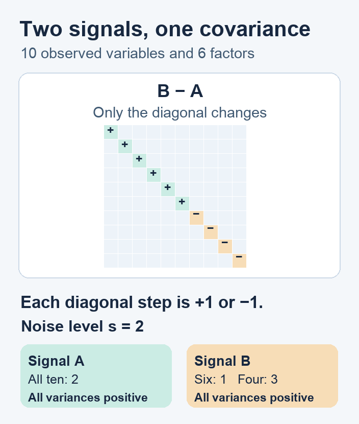

# Variance identifiability at the Ledermann bound

  

At every remaining Ledermann equality pair, the real factor model has an open set where the positive diagonal variances are unique and another open set where at least two different positive diagonals give the same covariance. Thus generic global identifiability fails, both for unrestricted loadings and after triangular normalization up to column signs. The result covers nullity m ≥ 4, beginning with 10 observed variables and 6 factors.

[Read the paper](paper/manuscript.pdf) · [LaTeX source](paper/manuscript.tex) · [Proof outline](proof/PROBLEM_AND_PROOF.md) · [Run the replay](REPRODUCIBILITY.md)

## Two signals, one covariance

In the exact ten-variable example, the signal matrices A and B differ by +1 in six diagonal entries and −1 in four. For Σ = A + 2I, signal A uses ten variances equal to 2. Signal B uses six variances equal to 1 and four equal to 3. Lowering the noise to 1/2 rules out B in this pair. The separate small-noise proof guarantees global uniqueness sufficiently close to A.

[Download the offline explorer](https://raw.githubusercontent.com/DannyExperiments/ledermann-bound-variance-identifiability/refs/tags/v1.0.0/visualization/variance-tradeoff-explorer.zip), extract it and open index.html to vary the noise. [Figure guide](visualization/README.md)

## Sources and verification

The question is in [Sturma et al., Theorem 3.7 and Example 3.8](https://doi.org/10.1017/psy.2026.10079) and [catalog Q404](https://github.com/10m-u/open-problems-catalog/blob/ca8d4d44ba3db527f19f28928c240168f545ecfe/problems/mathematics/mathematical-statistics.md#q404). The theorem concerns real positive variances. The proofs do not count all the completions in the ambiguous region. The exact replay verifies rational witnesses at the first two remaining equality pairs.

[Mathematical audit](audits/public_safe_reports/MATHEMATICAL_AUDIT.md) · [Literature audit](audits/public_safe_reports/LITERATURE_AUDIT.md) · [Scope](CLAIM_SCOPE_AND_LIMITATIONS.md) · [AI disclosure](AI_DISCLOSURE.md) · [Status](STATUS.md)

[Release v1.0.0](https://github.com/DannyExperiments/ledermann-bound-variance-identifiability/releases/tag/v1.0.0) · [Version DOI](https://doi.org/10.5281/zenodo.24570450) · [Citation](CITATION.cff)
